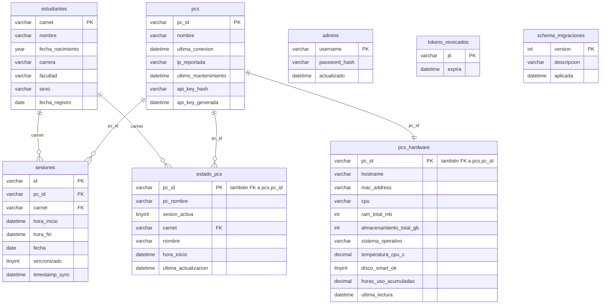

# Esquema de base de datos — Biblioteca Control de Acceso

Fuente de verdad: [`schema.py`](./schema.py) (`init_db()`), ejecutado en cada
arranque del servidor. Las bases creadas con versiones anteriores se ponen al
día con las migraciones versionadas de `MIGRACIONES` (ver el final de este
documento). Este documento refleja el estado **final** (tras esas migraciones).

Las columnas `DATETIME` guardan hora local de El Salvador (`TZ` de los
contenedores) sin zona, salvo las marcadas como UTC.

Motor: MySQL, `ENGINE=InnoDB` en todas las tablas.

## Diagrama de relaciones

`admins`, `tokens_revocados` y `schema_migraciones` no tienen relaciones con el resto.

## Tablas

### `estudiantes`

| Columna | Tipo | Notas |
|---|---|---|
| `carnet` | `VARCHAR(30)` | **PK** |
| `nombre` | `VARCHAR(255)` | |
| `fecha_nacimiento` | `YEAR` | Solo año (el kiosko no captura fecha completa). Migrada desde `DATE` — ver nota abajo. |
| `carrera` | `VARCHAR(255)` | |
| `facultad` | `VARCHAR(255)` | |
| `sexo` | `VARCHAR(20)` | |
| `fecha_registro` | `DATE` | `NOT NULL` |

> `departamento` existió en versiones anteriores y se elimina automáticamente
> si `init_db()` la encuentra.

### `pcs`

Catálogo de equipos (kioscos) registrados.

| Columna | Tipo | Notas |
|---|---|---|
| `pc_id` | `VARCHAR(100)` | **PK** |
| `nombre` | `VARCHAR(255)` | |
| `ultima_conexion` | `DATETIME` | |
| `ip_reportada` | `VARCHAR(45)` | IPv4/IPv6 |
| `ultimo_mantenimiento` | `DATETIME` | Fecha del último mantenimiento (`POST /pcs/{pc_id}/mantenimiento`) |
| `api_key_hash` | `VARCHAR(255)` | SHA-256 de la API key de la PC; `NULL` = sin key propia |
| `api_key_generada` | `DATETIME` | Cuándo se generó o rotó la key |

`ultima_conexion` e `ip_reportada` se actualizan en cada `POST /estado` y `POST /sync`; `/reportes/pcs-activas` usa `ultima_conexion`.

### `sesiones`

Historial de sesiones de uso (una fila por sesión, sincronizada desde los kioscos).

| Columna | Tipo | Notas |
|---|---|---|
| `id` | `VARCHAR(100)` | **PK** |
| `pc_id` | `VARCHAR(100)` | `NOT NULL` · **FK** → `pcs.pc_id` |
| `carnet` | `VARCHAR(30)` | **FK** → `estudiantes.carnet` · nullable (sesiones de invitado) |
| `hora_inicio` | `DATETIME` | `NOT NULL` |
| `hora_fin` | `DATETIME` | |
| `fecha` | `DATE` | `NOT NULL` |
| `sincronizado` | `TINYINT(1)` | default `0` |
| `timestamp_sync` | `DATETIME` | |

Índices: `idx_sesiones_fecha (fecha)`, `idx_sesiones_carnet (carnet)`, `idx_sesiones_pc_id (pc_id)`.

### `estado_pcs`

Snapshot del estado actual de cada PC (una fila por PC, se sobrescribe).

| Columna | Tipo | Notas |
|---|---|---|
| `pc_id` | `VARCHAR(100)` | **PK** · **FK** → `pcs.pc_id` |
| `pc_nombre` | `VARCHAR(255)` | |
| `sesion_activa` | `TINYINT(1)` | default `0` |
| `carnet` | `VARCHAR(30)` | **FK** → `estudiantes.carnet` · `ON DELETE SET NULL` |
| `nombre` | `VARCHAR(255)` | nombre del estudiante en la sesión activa (denormalizado) |
| `hora_inicio` | `DATETIME` | |
| `ultima_actualizacion` | `DATETIME` | |

### `pcs_hardware`

Telemetría de hardware por PC (una fila por PC, se sobrescribe).

| Columna | Tipo | Notas |
|---|---|---|
| `pc_id` | `VARCHAR(100)` | **PK** · **FK** → `pcs.pc_id` |
| `hostname` | `VARCHAR(255)` | |
| `mac_address` | `VARCHAR(20)` | |
| `cpu` | `VARCHAR(255)` | |
| `ram_total_mb` | `INT` | |
| `almacenamiento_total_gb` | `INT` | |
| `sistema_operativo` | `VARCHAR(255)` | |
| `temperatura_cpu_c` | `DECIMAL(5,1)` | |
| `disco_smart_ok` | `TINYINT(1)` | |
| `horas_uso_acumuladas` | `DECIMAL(8,2)` | `NOT NULL DEFAULT 0` |
| `ultima_lectura` | `DATETIME` | |

### `admins`

Administradores del panel. Se siembra el primero desde `ADMIN_USER`/`ADMIN_PASS_HASH` si la tabla está vacía.

| Columna | Tipo | Notas |
|---|---|---|
| `username` | `VARCHAR(100)` | **PK** |
| `password_hash` | `VARCHAR(255)` | `NOT NULL` · `pbkdf2_sha256$<iteraciones>$<salt>$<hash>` |
| `actualizado` | `DATETIME` | UTC · último cambio de contraseña; los JWT emitidos antes quedan revocados |

### `tokens_revocados`

JWT dados de baja con `POST /auth/logout`. Las filas vencidas se purgan en cada logout.

| Columna | Tipo | Notas |
|---|---|---|
| `jti` | `VARCHAR(64)` | **PK** · claim `jti` del token |
| `expira` | `DATETIME` | `NOT NULL` · UTC · `exp` del token. Índice `idx_tokens_revocados_expira` |

### `schema_migraciones`

| Columna | Tipo | Notas |
|---|---|---|
| `version` | `INT` | **PK** · número de la migración en `MIGRACIONES` |
| `descripcion` | `VARCHAR(255)` | `NOT NULL` |
| `aplicada` | `DATETIME` | `NOT NULL` · UTC |

## Notas de migración vigentes

Las migraciones están versionadas en `MIGRACIONES` (`db/schema.py`) y se aplican
una sola vez al arrancar; las ya aplicadas quedan registradas en la tabla
`schema_migraciones` (`version`, `descripcion`, `aplicada`). Una base nueva nace
con el esquema completo desde los `CREATE TABLE` de `init_db`. Como el DDL de
MySQL no es transaccional, cada migración es idempotente: si falla a mitad, se
reintenta en el siguiente arranque. Hacé un backup (`scripts/backup_db.sh`)
antes de desplegar una versión que agregue migraciones.

1. `pcs`: se agregan `ultimo_mantenimiento`, `api_key_hash` y `api_key_generada` si faltan.
2. `sesiones.carnet` se relajó a `NULL` (permite sesiones de invitado sin carnet).
3. Se elimina `estudiantes.departamento` si existe.
4. `estudiantes.fecha_nacimiento`: si una base preexistente la tiene como `DATE`,
  se migra a `YEAR` vía columna auxiliar (`fecha_nacimiento_new`) para evitar
  que MySQL trunque el valor a `0000` en un `MODIFY` directo.
